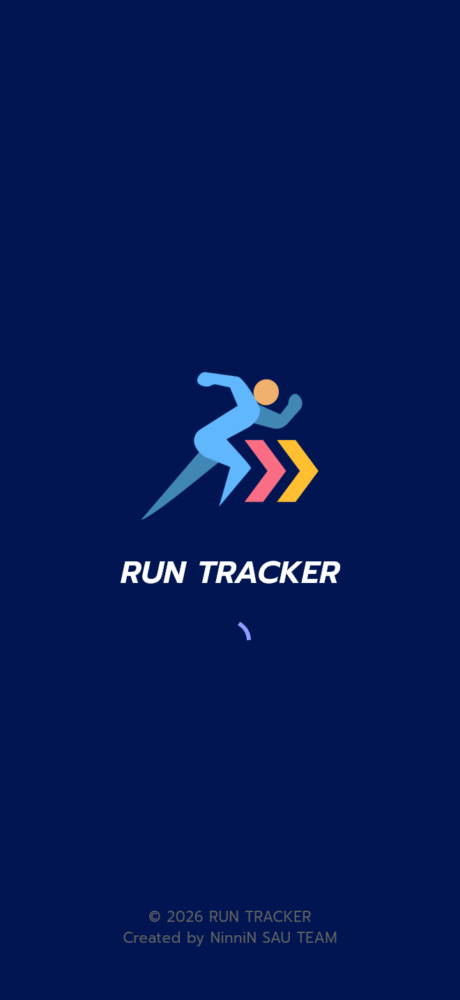
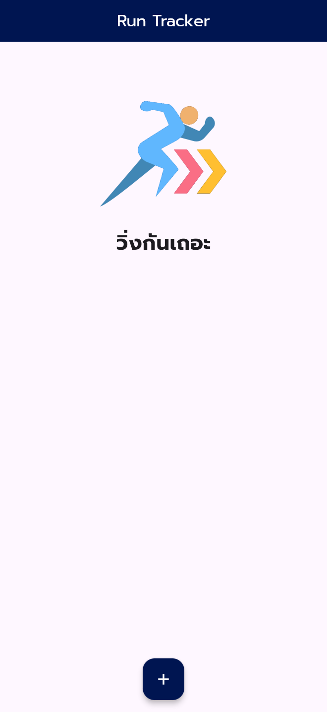
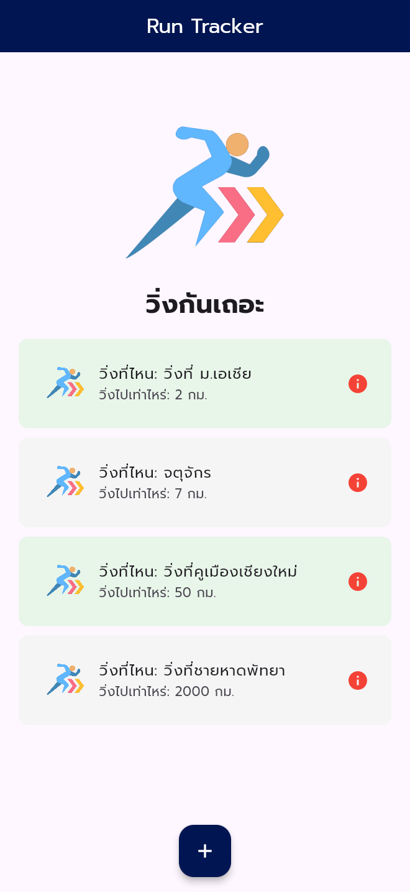
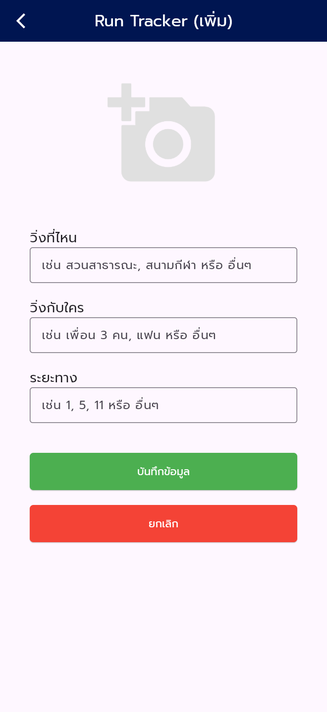
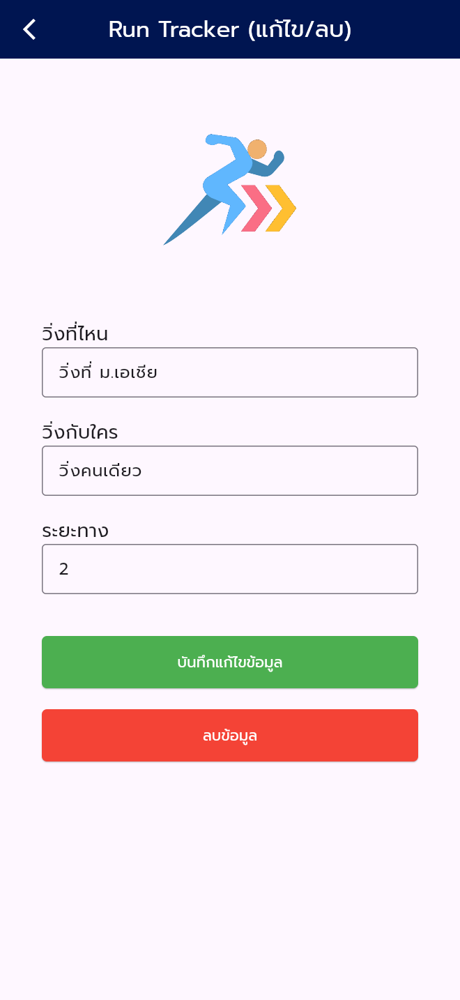

# 08-flutter_run_tracker_app

**Run Tracker** — a running log app built from the Figma file
"Project: flutter_run_tracker_app". Add a run (where, with whom, distance, optional photo
from the camera), see all runs, then tap one to edit or delete it.
Main font: Prompt (google_fonts), the font used in the Figma screens.

## Screenshots

Captured from the running app at iPhone 16 Pro Max size (440 x 956).

<table>
  <tr>
    <td align="center"><br><b>SplashScreenUi</b><br>หน้าแรก</td>
    <td align="center"><br><b>ShowAllRunUi</b><br>ยังไม่มีข้อมูล</td>
    <td align="center"><br><b>ShowAllRunUi</b><br>มีข้อมูลแล้ว</td>
  </tr>
  <tr>
    <td align="center"><br><b>AddRunUi</b><br>เพิ่มข้อมูล</td>
    <td align="center"><br><b>UpdateDeleteRunUi</b><br>แก้ไข/ลบ</td>
    <td></td>
  </tr>
</table>

## Screens

| File | Class | Screen |
| --- | --- | --- |
| `lib/views/splash_screen_ui.dart` | `SplashScreenUi` | Logo, loading spinner; goes to ShowAllRunUi after 3 seconds |
| `lib/views/show_all_run_ui.dart` | `ShowAllRunUi` | All runs (tap one → edit/delete), **+** button → add |
| `lib/views/add_run_ui.dart` | `AddRunUi` | Optional camera photo, checks the input before saving; ยกเลิก clears everything |
| `lib/views/update_delete_run_ui.dart` | `UpdateDeleteRunUi` | Edit every field or take a new photo; ลบข้อมูล asks before deleting |

Shared parts: `lib/models/run.dart` (data), `lib/services/run_service.dart` (save/load),
`lib/utils/run_validator.dart` (input check) and `lib/widgets/run_widgets.dart` (app bar, fields, buttons, photo).

## Data

Same columns as the Supabase table `run_tb`:

| Column | Type | Field |
| --- | --- | --- |
| `id` | uuid | `Run.id` |
| `created_at` | timestamptz | `Run.createdAt` |
| `runWhere` | text | วิ่งที่ไหน |
| `runPerson` | text | วิ่งกับใคร |
| `runDistance` | int4 | ระยะทาง (กม.) |
| `runImageUrl` | text | photo link in the Storage bucket `run_bk` |

## Supabase

The app uses `supabase_flutter`. `main()` connects with the project URL and publishable key in
`lib/services/supabase_config.dart`, and every screen goes through `runService`
(`SupabaseRunService` in `lib/services/supabase_run_service.dart`):

| Action | Database `run_tb` | Storage `run_bk` |
| --- | --- | --- |
| Add (C) | insert the row | upload the photo first (if taken) |
| Show all (R) | select all, oldest first | photos load from their public links |
| Edit (U) | update the row | new photo: remove the old file, upload the new one |
| Delete (D) | delete the row | remove the photo (if any) |

Supabase setup (SQL Editor snippet "Run Tracker Tables & RLS Policies"):

- table `run_tb` with Row Level Security on, and select / insert / update / delete policies for `anon`
- public bucket `run_bk` with select / insert / update / delete policies for `anon` on its files

The app has no login, so anyone with the publishable key can read and change these runs and photos.
Tests use `LocalRunService` (in memory) instead of Supabase.

## Images

- Runner logo: cut from the splash screen image in the Figma file (`assets/images/runner_logo.png`).
- Launcher icon: the same logo on the app's navy color (flutter_launcher_icons).
- Camera placeholder: Material icon `add_a_photo`.

## Run

```sh
flutter pub get
flutter run -d chrome
```

## Quality checks

```sh
flutter analyze
flutter test
```
